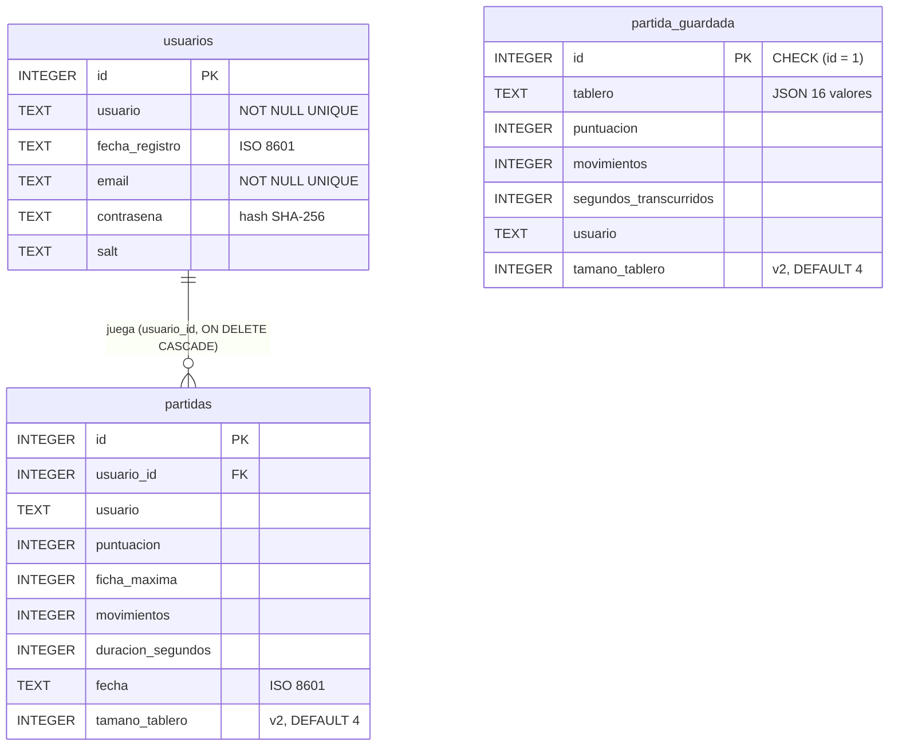
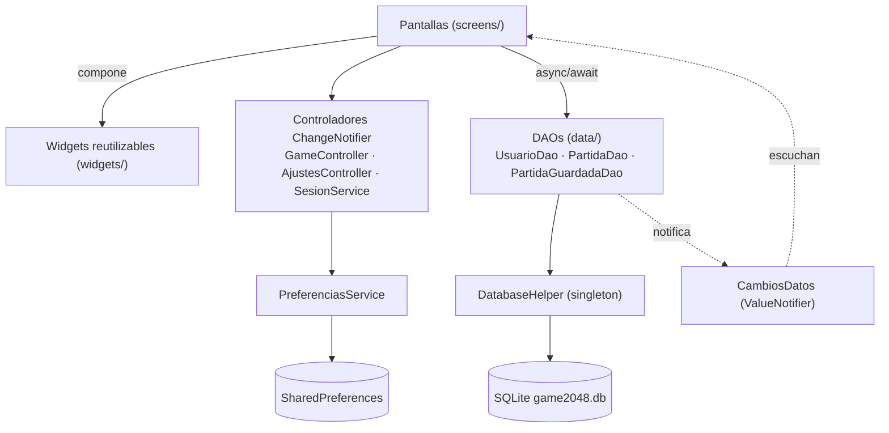
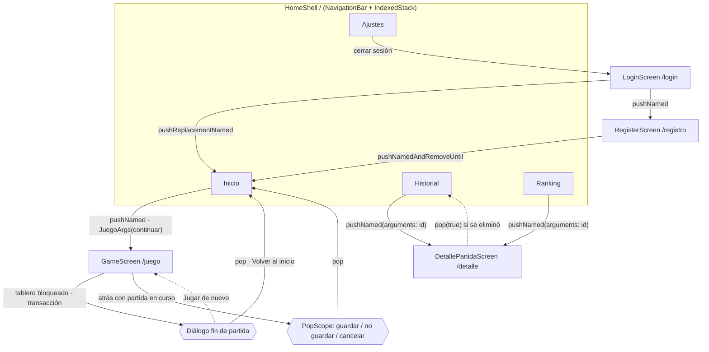

# 1. Acceso a datos

## 1.1 Modelo de datos




*Fuente Graphviz: `docs/img/er.dot`.*

La base de datos se llama `game2048.db` y tiene tres tablas:

- **usuarios**: jugadores registrados. `usuario` y `email` son `UNIQUE`. La contraseña **no se guarda en claro**: se guarda `SHA-256(salt + ":" + contraseña)` y un `salt` aleatorio de 16 bytes por usuario (`PasswordHasher`). La columna se llama `contrasena` (sin «ñ») para no tener que escribir el identificador entre comillas en el SQL.
- **partidas**: historial de partidas terminadas. Está **normalizada** con una clave foránea `usuario_id → usuarios.id` (`ON DELETE CASCADE`). Se mantiene también la columna `usuario` (TEXT) que pide el enunciado; así el historial se puede filtrar y agrupar por nombre sin un JOIN.
- **partida_guardada**: estado de la partida en curso. `CHECK (id = 1)` garantiza que solo existe una fila. El tablero se guarda como JSON con los 16 valores.

Columnas añadidas y por qué: `salt` (necesario para cifrar la contraseña), `usuario_id` (normalización), `partida_guardada.usuario` (saber de quién es la partida a medias) y `tamano_tablero` (migración v2). Se crean índices sobre `puntuacion` y `usuario` para el ranking y los filtros.

Como hay clave foránea, las claves foráneas se activan en `onConfigure` con `PRAGMA foreign_keys = ON`.

## 1.2 Arquitectura de la capa de datos




| Pieza | Archivo | Responsabilidad |
|---|---|---|
| `DatabaseHelper` | `data/database_helper.dart` | **Singleton**. Abre la BD con `openDatabase`, define la versión, `onConfigure`, `onCreate` y `onUpgrade`. |
| Modelos | `models/` | `Usuario`, `Partida`, `PartidaGuardada`, `EstadisticasGlobales`, `EstadisticasJugador` con `toMap()` / `fromMap()`. |
| DAOs | `data/usuario_dao.dart`, `partida_dao.dart`, `partida_guardada_dao.dart` | **Todo el SQL** de la app. Ninguna pantalla contiene SQL ni usa `Database`. |
| `DataException` | `data/data_exception.dart` | Los DAOs capturan `DatabaseException` con `try/catch` y lanzan un error con un mensaje para el usuario. |
| `CambiosDatos` | `data/cambios_datos.dart` | `ValueNotifier` que los DAOs incrementan tras cada escritura. Historial, Ranking e Inicio lo escuchan y vuelven a consultar sin reiniciar la app. |
| `PreferenciasService` | `services/preferencias_service.dart` | Único punto de acceso a `SharedPreferences`; claves como constantes. |

Reglas que se cumplen en todo el código:

- **Consultas parametrizadas** siempre (`where: 'id = ?', whereArgs: [id]`, `LIKE ?`, `rawQuery(sql, [args])`). Nunca se concatena un valor del usuario en el SQL.
- **Todo es asíncrono** (`Future`, `async/await`) y las pantallas muestran carga/error/datos con `AsyncDataView`.
- **Transacción** en `PartidaDao.registrarPartidaTerminada()`: con `db.transaction` se inserta la fila en `partidas` y se borra `partida_guardada` de forma atómica.

Operaciones implementadas:

| Tipo | Método (DAO) | SQL |
|---|---|---|
| Insertar partida | `PartidaDao.insertar` / `registrarPartidaTerminada` | `INSERT` (+ `DELETE` en transacción) |
| Historial por fecha | `obtenerHistorial` | `ORDER BY fecha DESC` |
| Detalle por id | `obtenerPorId` | `WHERE id = ?` |
| Eliminar una / todas | `eliminar`, `eliminarTodo` | `DELETE` (con confirmación en la UI) |
| Deshacer borrado | `restaurar` | `INSERT ... REPLACE` con el id original |
| Partida en curso | `PartidaGuardadaDao.guardar / recuperar / borrar / existe` | `INSERT OR REPLACE`, `SELECT`, `DELETE`, `COUNT` |
| Ranking | `ranking(limite: 10)` | `ORDER BY puntuacion DESC LIMIT 10` |
| Estadísticas globales | `estadisticasGlobales` | `COUNT`, `MAX`, `AVG`, `MAX`, `SUM` |
| Por jugador | `estadisticasPorJugador` | `GROUP BY usuario` |
| Filtros | `filtrar(jugador:, fichaMinima:)` | `usuario LIKE ? AND ficha_maxima >= ?` |
| Login / registro | `UsuarioDao.autenticar / registrar` | `WHERE usuario = ?`, `INSERT` (UNIQUE) |

## 1.3 Migración de la versión 1 a la 2

- **v1** (primer commit de la capa de datos): `usuarios`, `partidas`, `partida_guardada`.
- **v2** (al final del desarrollo): se añade `tamano_tablero INTEGER NOT NULL DEFAULT 4` a `partidas` y `partida_guardada`.

`DatabaseHelper` tiene un mapa `versión → migración` y un método `_migrar(desde, hasta)` que aplica en orden las que faltan:

```dart
static const int version = 2;
static final _migraciones = { 2: _migracionV2 };

Future<void> _onCreate(Database db, int v) async {
  await _crearEsquemaV1(db);   // instalación nueva
  await _migrar(db, 1, v);     // + todas las migraciones
}
Future<void> _onUpgrade(Database db, int oldV, int newV) =>
    _migrar(db, oldV, newV);   // usuario que ya tenía la v1

static Future<void> _migracionV2(Database db) async {
  await db.execute('ALTER TABLE partidas ADD COLUMN '
      'tamano_tablero INTEGER NOT NULL DEFAULT 4');
  await db.execute('ALTER TABLE partida_guardada ADD COLUMN '
      'tamano_tablero INTEGER NOT NULL DEFAULT 4');
}
```

`ALTER TABLE ... ADD COLUMN` no borra ninguna tabla: las filas existentes se conservan y reciben el valor por defecto 4. Una instalación nueva y una actualizada acaban con el mismo esquema. Para la próxima versión bastaría añadir `3: _migracionV3` y subir `version`. Los modelos leen la columna con `?? 4`, así que también funcionan con filas antiguas.

**Cómo comprobarlo:** instalar la app desde el commit con `version = 1`, jugar alguna partida, actualizar al commit final (`version = 2`) con `flutter run` sin desinstalar: el historial sigue ahí y el detalle muestra «Tablero 4×4».

## 1.4 Preferencias con shared_preferences

- `PreferenciasService` encapsula `SharedPreferences`. Claves constantes: `modo_tema`, `paleta_fichas`, `ultimo_jugador`, `mejor_puntuacion`, `vibracion`.
- `guardarModoTema(ThemeMode)` / `leerModoTema()`; si no hay valor se devuelve `ThemeMode.system`.
- En `main()` se llama a `WidgetsFlutterBinding.ensureInitialized()` y se hace `await PreferenciasService.cargar()` **antes de `runApp`**, así el primer frame ya sale con el tema correcto (sin parpadeo).
- `AjustesController` (ChangeNotifier) guarda el modo, la paleta y la vibración. `MaterialApp` está dentro de un `ListenableBuilder` con `theme`, `darkTheme` y `themeMode`: el cambio se ve **al instante** en toda la app.
- En Ajustes: `SegmentedButton` Claro / Oscuro / Sistema y selector de **paleta de fichas** (Clásica, Océano, Bosque, Atardecer), cada una en versión clara y oscura.
- Ampliaciones opcionales hechas: último jugador (rellena el login), mejor puntuación (se muestra en Inicio en cuanto arranca) y activar/desactivar vibración al fusionar.

# 2. Desarrollo de interfaces

## 2.1 Pantallas

| Pantalla | Archivo | Contenido |
|---|---|---|
| Login / Registro | `login_screen.dart`, `register_screen.dart` | Validación de campos, email con `@` y formato correcto, contraseña de 6 caracteres como mínimo y repetida. |
| Inicio | `inicio_screen.dart` | Título, mejor puntuación (`ScoreCard`), Nueva partida, **Continuar** (solo si hay partida guardada, con aviso), Historial, Ranking y Ajustes. |
| Juego | `game_screen.dart` | Tablero 4×4, Puntos, Mejor, Movimientos, Cronómetro, Guardar y Reiniciar. Diseño propio en horizontal. |
| Historial | `historial_screen.dart` | Lista con filtro por jugador (texto, con *debounce*) y por ficha mínima (desplegable). |
| Detalle | `detalle_partida_screen.dart` | Puntuación, ficha máxima, movimientos, duración, fecha y tablero. |
| Ranking | `ranking_screen.dart` | Estadísticas globales, Top 10 y tabla por jugador. |
| Ajustes | `ajustes_screen.dart` | Tema, paleta de fichas, vibración, borrar historial y cerrar sesión. |

## 2.2 Navegación




*Las flechas indican cómo se llega a cada pantalla y qué datos se pasan.*

- **Rutas centralizadas** en `lib/routes.dart` (`AppRoutes`): rutas con nombre y `onGenerateRoute`. Todas las pantallas navegan con `Navigator.pushNamed(...)`. No hay `MaterialPageRoute` repartidos por el código.
- **Paso de datos**: Historial/Ranking → Detalle pasa **solo el `id`** (`arguments: p.id`). El detalle consulta `PartidaDao.obtenerPorId(id)`.
- **Devolución de resultados**: si se elimina en el detalle se hace `Navigator.pop(context, true)`. El historial hace `await pushNamed<bool>` y, si recibe `true`, recarga y muestra un SnackBar.
- **Botón atrás en el juego**: `PopScope(canPop: !partidaEnCurso)`. Si hay partida en curso aparece un diálogo con **Guardar y salir / Salir sin guardar / Cancelar**, que llama a `PartidaGuardadaDao.guardar()` o `borrar()`.
- **Arranque**: Inicio consulta `PartidaGuardadaDao.existe()`. Si hay partida, muestra el aviso y el botón Continuar, que abre `/juego` con `JuegoArgs(continuar: true)`, y el juego carga el estado desde la BD.
- **Fin de partida**: diálogo con la puntuación y **Jugar de nuevo / Volver al inicio**. Antes se registra la partida con la transacción.

## 2.3 Gestos implementados

| Gesto | Widget | Pantalla | Comportamiento |
|---|---|---|---|
| Deslizar en 4 direcciones | `GestureDetector` `onPanStart/Update/End` (`BoardWidget`) | Juego | Acumula el desplazamiento. Ignora los gestos de menos de 24 px (o menos de 12 px si no son rápidos) y elige el **eje dominante** (`detectarDireccionSwipe`). |
| Flechas del teclado y botones | `Focus.onKeyEvent` + `IconButton.filledTonal` | Juego | Alternativa accesible al gesto (se han hecho las dos). |
| Deslizar para descartar | `Dismissible` | Historial | Borra la partida y muestra un SnackBar con **Deshacer**, que la vuelve a insertar con el mismo id. |
| Pulsación larga | `ListTile.onLongPress` | Historial | Hoja inferior con «Ver detalle» y «Eliminar» (con confirmación). |
| Pulsación simple | `ListTile.onTap` | Historial / Ranking | Abre el detalle pasando el id. |
| Arrastrar hacia abajo | `RefreshIndicator` | Historial / Ranking | Vuelve a consultar la base de datos. |
| Doble toque | `GestureDetector.onDoubleTap` (`ScoreCard`) | Juego (marcador «Puntos») | Muestra u oculta los detalles: ficha máxima y puntos por movimiento. |

**Por qué `onPan*` y no `onHorizontalDragEnd` + `onVerticalDragEnd`:** si se registran los dos recognizers compiten en la *gesture arena* y gana el primero que supera su umbral en su eje, antes de saber cuál es el eje dominante. Con `onPan` tenemos el vector completo `(dx, dy)` y decidimos nosotros. Ningún gesto borra datos sin confirmación o sin poder deshacerlo.

## 2.4 Reutilización de widgets

Todos están en `lib/widgets/`, cada uno en su archivo. Reciben datos y callbacks por constructor, no acceden a la BD y usan constructores `const`.

| Widget | Tipo | Dónde se usa |
|---|---|---|
| `TileWidget` | Stateless (+ animaciones implícitas) | Tablero, **detalle**, **diálogo de fin**, **lista de partidas**, **vista previa de paletas en Ajustes** |
| `BoardWidget` | Stateful (guarda el gesto en curso) | Juego |
| `ScoreCard` | Stateless | **Juego** (Puntos, Mejor, Mov., Tiempo) e **Inicio** (Mejor) |
| `StatCard` | Stateless | **Ranking** (estadísticas) y **Detalle de partida** |
| `PartidaListItem` | Stateless | **Historial** y **Ranking** (Top 10 con posición) |
| `ConfirmDialog` | Stateless | Borrar partida (historial y detalle), **borrar historial**, reiniciar partida, nueva partida descartando la guardada, cerrar sesión |
| `EmptyStateView` | Stateless | **Historial** (vacío / filtros sin resultados), **Ranking**, **Detalle** (partida inexistente), estado de error de `AsyncDataView` |
| `AsyncDataView<T>` | Stateless (`FutureBuilder`) | **Historial**, **Detalle** y **Ranking** |

Animaciones: aparición de ficha nueva (`TweenAnimationBuilder` de escala), «pop» al fusionar (`AnimatedScale`), cambio de color (`AnimatedContainer`), marcador (`AnimatedSwitcher`) y panel de detalles (`AnimatedSize`).

Constantes visuales en `theme/app_theme.dart`: `AppSpacing`, `AppSizes`, `AppTextStyles`, paletas `PaletaFichas` y la extensión de tema `TileColors`. Los colores de las fichas se leen con `Theme.of(context).extension<TileColors>()`, así que cambian al instante con el modo o la paleta. El color del texto de cada ficha se calcula por contraste (`estimateBrightnessForColor`) para que se lea bien en ambos modos.

## 2.5 Justificación de las decisiones de diseño

**Componente de navegación — `NavigationBar` (Material 3).** Las cuatro secciones principales (Inicio, Historial, Ranking, Ajustes) son del mismo nivel y se usan a menudo. Una barra inferior las deja siempre a un toque con el pulgar. Un `Drawer` las escondería y un `TabBar` se confunde con los gestos horizontales. Las pestañas van en un `IndexedStack` para que cada una conserve su estado (filtros, scroll). El juego y el detalle son pantallas «hijas», se abren encima (rutas con nombre) y ocultan la barra para dar todo el espacio al tablero.

**Gestor de estado — `ChangeNotifier` + `ListenableBuilder` (sin paquetes externos).** `AjustesController` (tema y paleta, aplicado en tiempo real a `MaterialApp`), `GameController` (estado del tablero y cronómetro, separado de la UI) y `CambiosDatos` (`ValueNotifier` que avisa a las listas cuando cambia la BD). Las dependencias (DAOs y ajustes) se inyectan con un `InheritedWidget` (`AppScope`). Es suficiente para el tamaño de la app, no añade dependencias y se explica fácilmente en la defensa.

**Estructura de carpetas.**
`models/` (datos puros con `toMap/fromMap`) · `data/` (DatabaseHelper, DAOs, excepciones, notificador) · `services/` (preferencias, ajustes, sesión, hash de contraseñas) · `game/` (lógica pura del 2048, con tests, y su controlador) · `screens/` · `widgets/` · `theme/` · `utils/` (formato y validadores) · `routes.dart`, `app.dart`, `main.dart`. Cada capa solo depende de las inferiores: las pantallas usan DAOs y widgets, y los widgets no conocen la BD.

# 3. Capturas de pantalla

> **Pendiente de completar por el alumno**: ejecutar en el emulador y guardar las capturas en `docs/capturas/` con estos nombres. Después regenerar el PDF (ver README).

| Captura | Archivo |
|---|---|
| Login y registro | `login.png`, `registro.png` |
| Inicio (claro / oscuro) | `inicio_claro.png`, `inicio_oscuro.png` |
| Juego (claro / oscuro) | `juego_claro.png`, `juego_oscuro.png` |
| Juego en **horizontal** | `juego_horizontal.png` |
| Historial (claro / oscuro) | `historial_claro.png`, `historial_oscuro.png` |
| Detalle (claro / oscuro) | `detalle_claro.png`, `detalle_oscuro.png` |
| Ranking (claro / oscuro) | `ranking_claro.png`, `ranking_oscuro.png` |
| Ajustes (claro / oscuro) | `ajustes_claro.png`, `ajustes_oscuro.png` |
